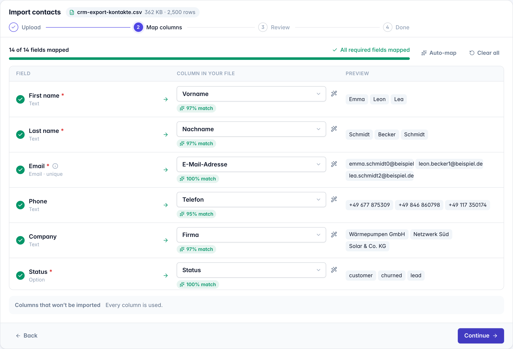
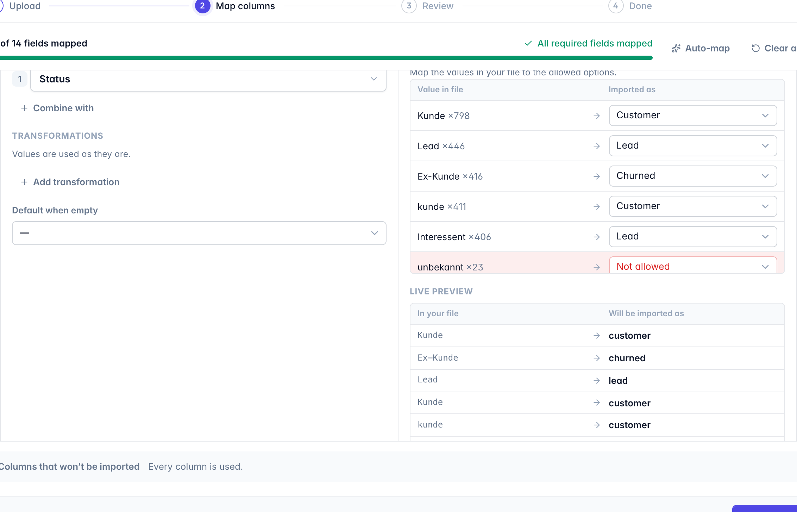
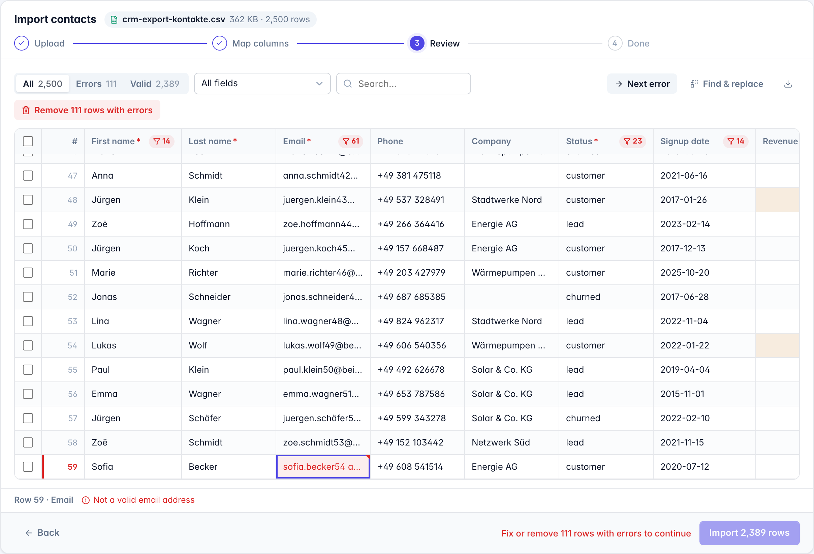
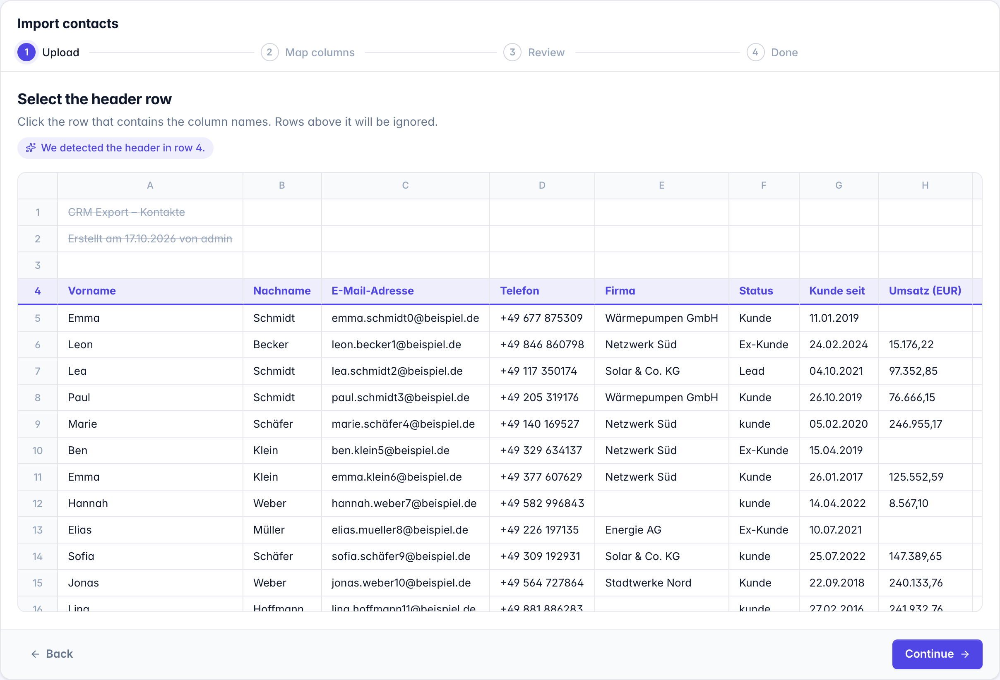
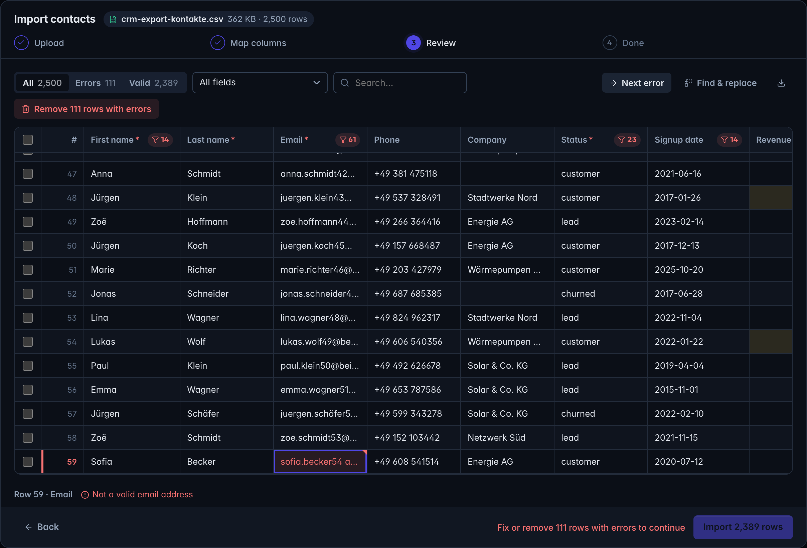

<div align="center">

# OpenImport

**An open-source TypeScript import engine with an optional React mapping interface.**

Independent format plugins, portable mappings, local processing by default, and persistence your application owns. The mapping experience is modelled on tools like OneSchema; the scope is the import itself, with no backend, hosted service or per-row pricing.

[Quick start](#quick-start) · [Why](#why-openimport) · [Packages](#packages) · [Docs](./docs/index.md) · [Playground](#playground) · [Roadmap](./docs/roadmap.md)



</div>

---

## Why OpenImport?

CSV importers are easy to start and hard to finish. Most of the work is in the details: header rows buried under a title line, `1.234,56` vs `1,234.56`, `15.03.2024` vs `03/15/2024`, "Ja/Nein", a customer who sends `Kunde` instead of `customer`, a nested JSON API export, a 50,000-row file, and the user who just wants to fix three typos without starting over.

OpenImport handles these cases and stays out of your way:

- **Headless by default.** A framework-agnostic TypeScript engine owns the whole import lifecycle: parse → detect header → map → transform → validate → review → submit. Use the ready-made UI, build your own with the React hooks, or run imports on the server without any UI at all.
- **Pluggable where it matters.** File formats, column matchers (fuzzy, AI, your own), transforms and event listeners are plugins with one small contract and a conformance suite. Field types and validation live in the schema, persistence in `onSubmit`, limits and policies in config.
- **Polished out of the box.** `@openimport/ui` provides a complete, accessible, themeable and translatable importer with keyboard navigation, dark mode, a virtualized review grid and live mapping previews.
- **Large files without a frozen page.** Opt into `@openimport/worker` and parsing, validation and the review rows move into a Web Worker, for every file or only above a size you choose. The UI and hooks don't change.
- **Your data stays local.** No backend, no auth, no telemetry. Records go wherever your `onSubmit` sends them.

## Quick start

```bash
npm i @openimport/core @openimport/ui @openimport/react @openimport/csv @openimport/xlsx
```

```tsx
import { createImporter, defineSchema, field } from '@openimport/core'
import { csv } from '@openimport/csv'
import { xlsx } from '@openimport/xlsx'
import { Importer } from '@openimport/ui'
import '@openimport/ui/styles.css'

const contacts = defineSchema({
  id: 'contacts',
  fields: {
    firstName: field.string({ required: true }),
    lastName: field.string(),
    email: field.email({ required: true, unique: true }),
    status: field.enum(['lead', 'customer', 'churned']),
    signupDate: field.date(),
    'address.city': field.string({ label: 'City' }),
  },
})

const importer = createImporter({ schema: contacts, plugins: [csv(), xlsx()] })

export function ImportContacts() {
  return (
    <Importer
      importer={importer}
      title="Import contacts"
      // Persist here: runs in batches while the user waits; errors are shown and can be retried.
      onSubmit={async ({ records, batchId }) => {
        // records: { firstName: string; email: string; address: { city?: string }; … }[]
        await saveContacts(records, { idempotencyKey: batchId })
      }}
      // A notification once everything is saved.
      onComplete={({ result }) => toast(`${result.submitted} contacts imported`)}
    />
  )
}
```

### Already have a zod schema?

Pass it straight in. Fields, labels, required flags, enums, formats and nesting come from [Standard JSON Schema](https://standardschema.dev), and every record is validated by zod itself, with zod's error messages shown in the review grid. ArkType works the same way; valibot needs `toStandardJsonSchema()` from `@valibot/to-json-schema`. All three are covered by tests.

```ts
const importer = createImporter({
  schema: z.object({
    firstName: z.string().min(1),
    email: z.email().meta({ aliases: ['e-mail', 'mail'] }),
    plan: z.enum(['free', 'pro']).default('free'),
  }),
  plugins: [csv()],
})
```

## What's in the box

| | |
|---|---|
| **Formats** | CSV/TSV (zero-dependency streaming parser that detects the delimiter and encoding, including Windows-1252 and UTF-16 BOMs), Excel `.xlsx` (one dataset per sheet), JSON (finds every array of records, e.g. `$.data.customers[*]`), JSON Lines, XML (repeated elements, attributes, CDATA). Paste-from-spreadsheet. |
| **Header detection** | Finds the real header below title rows, blank lines and notes. Users can override it with one click. |
| **Column matching** | Normalized similarity, an EN/DE synonym dictionary (`Vorname` → `firstName`, `PLZ` → `zip`), field aliases, nested-path awareness (`name.family` → `lastName`) and a type check on sample values. Optional [AI matching](./packages/ai) with your own model. |
| **Mapping UX** | Target-centric mapping with live previews of real values, confidence badges, ranked column picker with sample values, "unused columns" overview, required-field tracking and one-click suggestions. |
| **Transforms** | Combine columns, template (`{2}, {1}`), split (first/last name), first non-empty, trim, case, find & replace, regex extract, prefix/suffix, all with a live preview. Plugins can add more. Every transform is declarative JSON, so recipes stay portable and safe. |
| **Value mapping** | `Kunde`, `Interessent` and `Ex-Kunde` get mapped to enum options automatically, and users can fix the rest in a table. |
| **Smart parsing** | Detects `DD.MM.YYYY` vs `MM/DD/YYYY` and decimal commas per column. Handles Excel serial dates, `€ 1.234,50`, `(42)`, `12%`, and booleans like `Ja/Nein/x/✓`. |
| **Validation** | Required, unique (across rows), min/max, length and pattern checks, custom field validators, cross-field row validators, **async batch validators** (e.g. "does this email already exist?"), and Standard Schema (zod, arktype, valibot). The same rules apply in the UI and in `run()`. Errors and warnings. |
| **Review** | Virtualized grid (50k+ rows), inline editing with re-validation, keyboard navigation, error filters per field, jump to next error, find & replace, bulk delete, and download of the rows with errors as CSV. |
| **Recipes** | Mapping decisions are remembered and re-applied when a file with similar headers is uploaded again. Recipes are plain JSON, so you can store them anywhere. |
| **Output** | Typed, nested records. Batched `onSubmit` with progress and idempotency keys, resumable after a failed batch, server-side rejections sent back to review, and an async-iterable `session.records()`. |
| **Headless runs** | `importer.run(file)` runs a whole import (detect, map, validate) batch by batch. Verified on Node, Bun and Deno in CI. CSV and JSON Lines stream; JSON, XML and Excel are parsed whole. |
| **i18n & theming** | English and German included, every string can be overridden. CSS variables, `accent` and `radius` props, light/dark/auto. |

<table>
<tr>
<td></td>
<td></td>
</tr>
<tr>
<td align="center"><sub>Transform & value mapping editor with live preview</sub></td>
<td align="center"><sub>Review grid: filter, jump to errors, fix inline</sub></td>
</tr>
<tr>
<td></td>
<td></td>
</tr>
<tr>
<td align="center"><sub>Header row detection below title lines</sub></td>
<td align="center"><sub>Dark mode</sub></td>
</tr>
</table>

## Packages

| Package | Description |
|---|---|
| [`@openimport/core`](./packages/core) | Headless engine: schema, session state machine, matching, transforms, validation, recipes, streaming runs. Zero dependencies. |
| [`@openimport/react`](./packages/react) | Provider and hooks (`useImportState`, `useUpload`, `useMapping`, `useReview`) for building a custom UI. |
| [`@openimport/ui`](./packages/ui) | The ready-made `<Importer>` / `<ImporterDialog>` plus composable step components. |
| [`@openimport/csv`](./packages/csv) | Streaming CSV/TSV with delimiter and encoding detection. Zero dependencies. |
| [`@openimport/xlsx`](./packages/xlsx) | Excel workbooks, one dataset per sheet. |
| [`@openimport/json`](./packages/json) | JSON (record discovery in nested documents) and JSON Lines. |
| [`@openimport/xml`](./packages/xml) | XML with repeated-element discovery. |
| [`@openimport/worker`](./packages/worker) | Run sessions in a Web Worker; the UI fetches only the rows it shows. |
| [`@openimport/ai`](./packages/ai) | Bring-your-own-model column matching, including split/combine suggestions. |

## Build your own UI

The UI is optional. The hooks give you everything the built-in importer uses:

```tsx
import { ImporterProvider, useImportState, useMapping, useSession, useUpload } from '@openimport/react'

function MyMapping() {
  const session = useSession()
  const { fields, requiredMissing, canConfirm } = useMapping()
  return (
    <>
      {fields.map(({ field, sources, status }) => (
        <MyFieldRow key={field.key} field={field} sources={sources} status={status} onPick={(col) => session.assign(field.key, col)} />
      ))}
      <button disabled={!canConfirm} onClick={() => session.confirmMapping()}>Continue</button>
    </>
  )
}
```

The core has no React dependency. Any framework can `session.subscribe()` and call actions. See [Session API](./docs/session.md).

## Headless & server-side

```ts
for await (const { records, invalid, issues } of importer.run(file, { batchSize: 1000 })) {
  await db.contacts.insertMany(records)
  report.push(...issues) // with source line numbers
}
```

Pass a saved `recipe` (or an explicit `mapping`) to reproduce what a user configured in the UI, including the header row and the dataset, for example for nightly SFTP imports. Recipes are validated before they run.

## Writing a plugin

```ts
import { definePlugin } from '@openimport/core'

export const fixedWidth = definePlugin({
  name: 'fixed-width',
  formats: [
    {
      id: 'fwf',
      label: 'Fixed width',
      extensions: ['txt', 'dat'],
      inspect: async (file) => ({ datasets: [{ id: 'default', label: file.name, layout: 'grid' }] }),
      async *read(file, { signal }) {
        const lines = (await file.blob.text()).split('\n')
        yield lines.map((l) => [l.slice(0, 10), l.slice(10, 30), l.slice(30)])
      },
    },
  ],
  transforms: [{ op: 'iban', label: 'Normalize IBAN', arity: 'one', apply: (v) => String(v).replace(/\s+/g, '').toUpperCase() }],
  matchers: [{ id: 'crm-codes', priority: 5, match: ({ sourceFields }) => [] }],
  onEvent: (event) => analytics.track(`import:${event.type}`),
})
```

Read [docs/plugins.md](./docs/plugins.md) for the full contract, including collision rules and capabilities. `checkPlugin()` from `@openimport/core/testing` verifies a plugin against it; [`examples/fixed-width-plugin`](./examples/fixed-width-plugin) is a complete third-party plugin.

## Playground

```bash
pnpm install
pnpm dev     # → landing page on http://localhost:5173, playground on /playground/
```

The playground is built with shadcn/ui on Tailwind v4 (sharp, `--radius: 0`); its design source lives in [`design/playground.pen`](./design). It ships messy sample files: a German CRM export with title rows, semicolons, decimal commas and typos; a nested API response; an XML export; and 50,000 rows to test performance. You can switch theme, accent, language, invalid-row policy and a demo AI matcher.

## Performance

`pnpm bench` imports a generated 50,000-row German CRM export (title rows, semicolons, `DD.MM.YYYY`, decimal commas, typos) and prints the time per stage. On Node 22 and an Apple M4 Pro:

```
file.inspect         3.6 ms   csv · delimiter=; encoding=utf-8
rows.read           99.0 ms   50,004 rows (header detection included)
columns.match       11.0 ms   8 suggestions
mapping.enrich       1.5 ms   8 of 8 fields mapped
rows.validate      234.3 ms   2,472 rows with errors
submit              36.5 ms   47,528 records in 48 batches
```

Pass a row count to try other sizes: `pnpm bench 200000`. The review grid renders only the visible rows, and validation yields to the main thread between chunks.

## Development

```bash
pnpm install
pnpm test          # vitest: node + happy-dom projects
pnpm typecheck
pnpm lint          # biome
pnpm build         # tsdown → ESM + .d.ts
```

Workspace packages resolve to their TypeScript sources through the `@openimport/source` export condition, so tests and the playground need no build step. See [CONTRIBUTING.md](./CONTRIBUTING.md).

## License

[MIT](./LICENSE)
